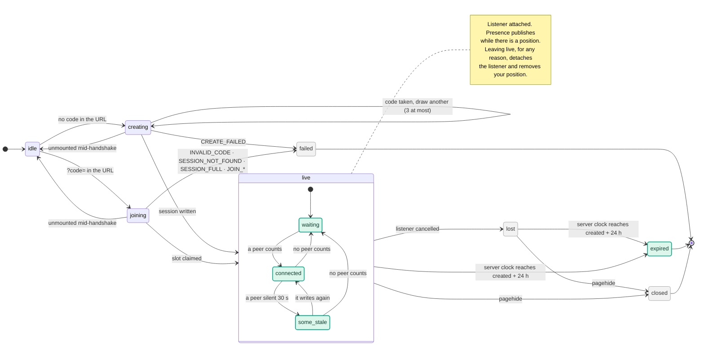

# Architecture

**Meet Me Halfway** is a zero-backend PWA. Every participant's browser runs the
same pipeline: read locations, compute a midpoint, find venues near it, and
route everyone to the meeting point. There is no server to coordinate them.

This document describes how that pipeline is structured and why.

---

## The two layers

```
apps/web/src/core/dag/            framework- and domain-agnostic execution core
apps/web/src/features/live-midpoint/graph/    this app's graph, built on it
```

`core/dag` knows nothing about maps, participants or React. It provides a
`Result` type, a transport error taxonomy, a circuit breaker, and one resource
combinator. `features/live-midpoint/graph` declares the actual nodes, their
edges, and the policies that govern them.

---

## Sources and nodes

The distinction that shapes everything else: **event streams are inputs to the
graph, not nodes in it.**

```
SOURCES (adapters — push into the runtime)   NODES (pure or policy-governed)

  useAuth ───────── uid ─┐
  useLiveSession ────────┼──► liveness ──► slots ──┬──► midpoint ──┬──► venues ─┐
  useLiveGeolocation ────┤   (clock)      (SoA,    │               │            │
  ui.selectedPlace ──────┤                 stable) │               └──► destination
  ui.travelProfile ──────┤                         │                        │
  ui.ownName ────────────┼──► presence ◄─┐         └──► phase               │
                         │   (RTDB write,│                ▲                 ▼
                         │    and delete)│                │   routes ──► frame
                         └──► expiry ────┴────────────────┘
                             (clock)
```

`useLiveGeolocation`, `useLiveSession`, `useAuth` and `useNetworkStatus` are
unchanged adapters. They own subscriptions and lifecycles; the graph derives
from what they emit and never writes back.

Edges are declared in `graph/edges.ts` and executed in topological order by
`graph/runtime.ts`. The declaration is load-bearing, not documentation: the
runtime walks `TOPO_ORDER`, and `assertAcyclic` runs at module load.

### Why the cycle check earns its place

There is no cycle today. There is one waiting. Re-centring venue search on the
selected venue, or deriving a time-balanced midpoint from route durations —
both natural next features — close `midpoint → venues → destination →
midpoint`. Either would ship as a hang discovered on somebody's phone. With
the edges declared, it is a failing test that names both nodes.

---

## Node contracts

| Node | Kind | Input | Output | On failure |
|---|---|---|---|---|
| `liveness` | pure | participants, server clock | `stale[]` + `departed[]` + `nextFlipAtMs` | — |
| `expiry` | pure | session, server clock | `expired` + `flipAtMs` | — |
| `slots` | pure | sources, `liveness` | `SlotVector` | — |
| `presence` | effectful | a live session, not expired, + own position | RTDB write; deletes what it wrote once that stops | report failed |
| `midpoint` | pure | `slots` | `LatLng \| null` | — |
| `phase` | pure | session, `expiry`, `slots`, `liveness` | `SessionPhase` | — |
| `venues` | effectful | `midpoint` | raw `PlaceResult[]`, ranked against the live midpoint, the pick pinned in | last answer while young, else says it failed |
| `destination` | pure | `midpoint`, `venues`, the pick | `LatLng \| null` | — |
| `routes` | effectful | counted `slots`, `destination`, profile | `RouteSet`: slot-keyed routes, tagged with the destination and profile they answer | degrade to last-good |
| `frame` | pure | all of the above | `GraphSnapshot` | — |

### Liveness holds one timer, not an interval

Staleness is `now - lastSeen >= 30s` — a predicate over a clock, exactly like
the breaker's cooldown. `liveness` returns the earliest instant at which some
participant's staleness flips, and the runtime arms a single wake for it.

This replaces a 10s `setInterval` that ran for the life of the session. The
argument is the one made for the breaker below and applies verbatim: mobile
browsers throttle `setInterval` to minutes and freeze it under bfcache, so a
tab resumed after ten minutes reported staleness from before it was
backgrounded. Recomputing from the clock has no such window.

The boundary is inclusive (`>=`) deliberately. With a strict `>`, a
participant was still fresh at the instant the wake fired, the node re-derived
the same target, and the wake re-armed at zero delay — the same livelock the
breaker had at its half-open boundary.

A second threshold rides on the same wake: at `now - lastSeen >= 120s` a
participant has **departed**. They are still drawn, dimmed as stale, but
`slots.counted` leaves them out, and the midpoint, the routes and the
`connected` phase are computed from `counted` alone. Before, a peer whose tab
froze in the background kept pulling the midpoint towards where they were
last seen for as long as their node stayed in the database.

`lastSeen` is the server's timestamp, so `now` is the server's clock:
`ports.now()` plus the `serverTimeOffsetMs` source (`.info/serverTimeOffset`).
Against the device clock alone, a phone running minutes slow saw a fresh peer
as stale, and one running fast saw a departed peer as live.

`expiry` is the same kind of node with a wake of its own: the session's 24
hours, `created + 24 h` against the server clock, mirroring the rules'
`now - 86400000`. The rules enforce it; the graph mirrors it only to know
when, so that it stops writing and says so instead of being refused.

### The slot is a server-arbitrated resource

A slot is claimed by writing `sessions/{code}/slots/{i}` under a write-once
rule, so the *database* decides who holds it. Exactly five such keys are
declared; anything else has no `.write` rule anywhere up the tree. That makes
the participant cap a property of the schema rather than a check a client can
skip, and it removes the client-side registry entirely — the three historical
slot bugs below become unrepresentable rather than defended against.

Write-once is also the concurrency control: two clients racing for one index
are serialised by the server and the loser gets `permission_denied`, so the
claim loop needs no transaction, only a retry on the next free index.

Claims are not released on disconnect. `onDisconnect` clears
`participants/{slot}`; the claim stays, so a reconnect returns to the same slot
and the same colour. A session that churns five distinct uids is therefore full
permanently — unchanged from the write-once `participantUids` it replaces.

`slots` is a **structure of arrays** indexed by `ParticipantIndex`, length
`MAX_PARTICIPANTS`, with `null` for a vacant slot. Routes, accuracy circles,
marker colours and Mapbox layer ids all key off the same `i`. They previously
did not, which is covered under *Slot identity* below.

---

## Session lifecycle

`useLiveSession` is a reducer over one union, and the graph derives what the
user sees from it. Green states are the graph's, derived from the roster and
the server clock with no timers in the hook; in grey ones nothing is
published; the rest are the reducer's.



`sessionReducer`'s tests walk every transition here. Five rules come with it:

- **One owner for own position.** The `presence` node publishes only into a
  `live` session that has not expired, with a position, and when any of that
  stops — location turned off, the session lost, expired or closed, the
  runtime disposed — it deletes what it published. The session hook used to
  delete it while the graph wrote it, and a write still retrying in the graph
  put back a position the hook had just removed.
- **Effects follow state.** Entering `live` attaches the participants
  listener and writes the code to the URL; leaving detaches it. Handshakes
  only report what happened, so nothing they do can outlive the state it was
  for.
- **Results of a handshake nobody waits on are dropped.** `creating` and
  `joining` carry the handshake's id; the reducer ignores anything from
  another — StrictMode's remount starts a second handshake before the first
  has noticed its abort. An ignored event returns the same object, so React
  does not even re-render.
- **Expiry is derived, not timed.** See `expiry` above. Every participant
  reaches `expired` within a second of the others.
- **One value at the boundary.** The graph takes the lifecycle as a single
  `SessionLifecycle`, not a code, a slot and a status that could disagree.

`pagehide` is the only teardown signal, and it acts synchronously: React would
render after the page is gone, so the handler pushes `closed` straight into the
graph — the presence node deletes the position over the socket that is still
open — and the render that follows pushes the same value, a no-op. The
server-side `onDisconnect` stays as the backstop. `beforeunload` is not used:
it exists so a page can cancel a navigation, so it fires for some that never
happen, and it used to tear down a page that stayed open.

Joining has no expiry check of its own. The rules refuse a read of an expired
session exactly as of a missing one, on purpose, so codes cannot be probed;
the join already reports it as not found, and that copy says the session may
have expired. The check that stood there compared `created` with the device's
clock, so it fired only when that clock ran fast.

---

## Resilience

Every effectful node is one `createResource` instance. The policy record
(`graph/policies.ts`) is the whole configuration surface:

| | debounce | maxWait | admit | timeout | retry | breaker | TTL | degrade |
|---|---|---|---|---|---|---|---|---|
| `venues` | 5 s | 15 s | 100 m | 8 s | 2 | 4 fails / 30 s | 5 min | last-good, else `failed` |
| `routes` | 3 s | 9 s | 200 m | 10 s | 2 | 5 fails / 60 s | 60 s | last-good |
| `presence` | 3 s | 3 s | 10 m | 10 s | 3 | 5 fails / 60 s | — | report failed |

`presence` is a **write**, and still one `createResource`: everything the
combinator provides is what the hand-rolled throttle in `useLiveSession` was
approximating. Its TTL is 0 because a write has no value to serve — there is
nothing to degrade *to*, so a failure is reported and the UI can say so.

A `Retry-After` on a 429 now floors the retry delay, and one too long to sleep
through inside a dispatch (> `retryBaseMs × 8`) becomes the breaker's cooldown
instead: the retry loop owns seconds, the breaker owns the long tail. The
header was previously parsed into the error and read by nobody.

Every attempt runs under its own `AbortController`, chained to the dispatch
signal, so a deadline cancels the request rather than merely stopping waiting
for it. It did not, and the retry went out alongside the request it replaced.

### One bulkhead across all nodes

`core/dag/semaphore.ts` caps total in-flight I/O at 4, applied at the
composition root rather than inside a policy. A breaker is reactive — it only
closes the tap after failures are paid for — and nothing bounded simultaneity:
a route dispatch fans out per occupied slot, against a six-per-host HTTP/1.1
cap the RTDB socket and map tiles also draw on.

### Two predicates, deliberately separate

- **`admits`** is metric and stateful. It compares the new input against the
  last input *actually dispatched*, so its baseline advances with every
  accepted call.
- **`identity`** is pure and depends only on the current input. It collapses
  concurrent duplicate requests, and it tells a re-offer from churn: the
  same request offered again keeps the deadline already scheduled for it.
  Every tick offers every node its input, so restarting the trailing
  debounce on each offer held every first fetch to its `maxWait`.

Quantising coordinates into grid cells is fine for `identity` — a collision
merely skips a duplicate. It must never gate admission. A stationary user
whose GPS noise straddles a cell boundary would flip cells at roughly 1 Hz and
pay for one API call per second, indefinitely. A displacement predicate
structurally cannot do that.

### The breaker holds no timer

`core/dag/breaker.ts` compares `openedAt + cooldown` against an injected
clock. Transitions are `closed → open → halfOpen → closed`, with the cooldown
doubling on each failed probe up to a ceiling. A probe refused with a rules
denial or a 4xx closes it as well: the dependency answered. A probe abandoned
because its input went away hands its permit back, and the next call probes.

Two reasons it is lazy rather than scheduled. A timer-driven probe reproduces
the exact bug it replaces — the old code doubled a backoff on HTTP 429 but the
movement guard returned before the timer was re-armed, so a stationary user
never recovered. And backgrounded mobile browsers throttle `setTimeout` to
minutes and freeze it entirely under bfcache, silently turning a 60-second
window into an indefinite one. A timestamp comparison is immune to both.

Admission is breaker-aware, so an elapsed cooldown is itself a reason to
dispatch; one backstop wake covers the case where inputs stop arriving.

### Degradation, not rollback

Nothing on the derived layer is compensable — it is all reads and pure
compute. So there is no rollback matrix, only a degradation policy per node.
The one genuinely compensable write path, the RTDB participant entry, already
has `onDisconnect` plus explicit `cleanup` in `useLiveSession`.

A degraded node keeps serving its last good value **only while younger than
its TTL**. Past that the value is dropped rather than served. A stale route is
a confident lie; falling back to nothing lets `MidpointCard` show an honest
straight-line distance instead.

Routes have a second condition: they are published only while they answer the
current destination and profile (`routesAnswer`, within the same 200 m that
decides a refetch), and only for slots still counted. The resource keeps its
last value through any change of input, so a venue picked, or the last peer
leaving, used to leave the previous routes drawn and listed — in the second
case indefinitely, since with no destination nothing would ever refetch.

---

## Atomic state

`graph/runtime.ts` exposes one frozen `GraphSnapshot`, consumed through
`useSyncExternalStore`. That contract requires `getSnapshot` to return a
referentially identical value when nothing changed, so:

- The snapshot is computed on **write**, never on read.
- `SlotVector` is compared element-wise, because RTDB hands over a fresh
  participants array on every heartbeat. Without that, each heartbeat would
  allocate a new vector and invalidate the whole graph.
- `setSources` takes a **patch object** rather than per-key setters, so a
  handler changing two sources produces one tick and one render.

The runtime is created **per mount**. A module singleton would survive
StrictMode's unmount/remount and hand the second mount the first's epoch
counters, breaker state and in-flight aborts; under Vitest it would bleed
state across files. `useGraphRuntime` detects the simulated teardown and
stands up a replacement, so `npm run dev` behaves like production.

The picked venue (`selectedPlace`) and `travelProfile` live in the runtime,
not React state. Mirroring them would create two sources of truth and the
venue list would highlight a venue the graph had already stopped routing to.
The pick is the place itself, not an id to look up: the venues node pins it
into the list (`rankWithPinned`), so it stays listed, clearable and the
destination until it is cleared — however the ranking moves, and after a
search stops returning it.

The snapshot says what the venue list knows in `venueStatus` — `searching`,
`ready` (a list, which may truthfully be empty) or `failed` — rather than in
a `loading` flag: a list is shown whenever there is one, through a refresh
and after a failure that left an earlier answer.

---

## Defects this structure fixed

All were verified in the code before being fixed, and all have regression
tests.

| Defect | Where it lived |
|---|---|
| **Slot identity.** Indices were a dense rank over a mutating set, recomputed per snapshot. A departure renumbered everyone after the leaver; own index was ranked over `participantUids` while others were ranked over `participants`, so two participants could share a slot; and a clamp aliased surplus uids onto the last slot. First fixed by a client-side registry, then made structurally impossible by moving the claim into the database. | `useLiveSession.assignIndex` |
| **Unenforced participant cap.** `MAX_PARTICIPANTS` was a client-side `if` in `joinSession` and nothing more, so any modified client could register unbounded `participantUids`. Honest clients dropped the surplus, which made it a session-integrity problem rather than an availability one — but the limit was not a limit. | rules + `useLiveSession` |
| **Route/colour misalignment.** `LiveMap` resolved accuracy circles by participant index but routes by array position, while painting both into slot `i`'s colour. For *any* joiner the two disagreed, so every route rendered under the wrong participant. `MidpointCard` consumed the same array correctly-by-position, so neither could be fixed alone. | `LiveMap` + `useDirections` |
| **Sticky rate limit.** A 429 doubled the debounce delay, but the movement guard returned before the timer was re-armed. With nobody moving, the failure was permanent. | `useDirections` |
| **Partial-failure wipeout.** `Promise.all` meant one participant's 429 discarded every route, and the state was never updated — leaving stale routes on screen with no indication. | `useDirections` |
| **Debounce starvation.** Both fetch hooks reset their timer on every dependency change, and dependencies changed at GPS rate. While a user walked, the first fetch could be starved indefinitely. | both hooks |
| **Loading flicker.** The success path checked the signal captured for that call, but `catch`/`finally` read whichever controller was current, so an abandoned request cleared `loading` under its replacement. | `useVenueSearch` |
| **Pinned stale selection.** Reconciliation only ran when the venue list was non-empty, so a search returning nothing left a deleted venue pinned as the destination. | `LiveMidpointPage` |
| **Unreachable 429.** `searchNearbyVenues` threw `RATE_LIMITED` and caught it in its own catch block two lines later, returning `[]`. Callers could not tell a rate limit from "no venues here". | `places-api` |
| **Three failure conventions.** Throw, return-empty, and set-a-state-code, in one codebase — plus two magic error strings no consumer read. | throughout |
| **Half-open livelock.** `retryAtMs()` returned `openedAt + openMs` whenever the breaker was not closed — while half-open, an instant already in the past. Admission read it as "cooldown over", `allow()` refused the call, and the backstop wake re-armed at `max(0, past − now)` = 0: an unbounded `setTimeout(…, 0)` chain for the whole life of the probe, on exactly the degraded network that opened the breaker. | `core/dag/breaker` |
| **Denial as a network failure.** A security-rules refusal of the presence write (a session past its 24 hours, say) was classified `NETWORK`: retried three times per write and counted towards opening the breaker on a healthy database. It is `DENIED` now, and neither. | `presence-rtdb` + `core/dag/errors` |
| **Discarded `Retry-After`.** Parsed into `RATE_LIMITED` and read by nobody, so a 429 saying 30 s was retried at 1 s and 2 s and counted twice against the breaker — the same class as the magic strings above. | `core/dag/errors` |
| **Uncancelled timeout.** The per-attempt deadline resolved `TIMEOUT` without aborting, so the retry went out beside the request it replaced: up to `retryAttempts × slots` sockets against a six-per-host cap. | `core/dag/resource` |
| **Stability discarded at the render boundary.** The graph returned stable `slots` and `routes`; the page rebuilt four projections with `.map()` in the render body and `LiveMap` was not memoised, so every GPS fix re-ran `setData` on five route sources — thousands of coordinate pairs per second for geometry that had not changed. | `LiveMidpointPage` + `LiveMap` |
| **Positional fit guard.** `fitBounds` jitter suppression compared a vector mixing participants, midpoint and venue by array index, so a joiner arriving as a venue was deselected made it measure a participant against a venue. Same aliasing class as slot identity. | `LiveMap` |
| **Unhandled join rejection.** `createSession`/`joinSession` threw into an effect with no `.catch()`; every failure raised an unhandled rejection on top of the Sentry event already recorded, and an unmount mid-join left a retry loop running against a dead component. | `useLiveSession` + page |
| **`setPhase` inside a `setParticipants` updater.** React requires updaters to be pure and StrictMode double-invokes them. `phase` was `useState` written from six sites despite being a total function of status, roster and liveness. | `useLiveSession` |
| **Polled staleness.** A 10 s `setInterval` drove a clock predicate, so a backgrounded tab reported staleness from before it was suspended — the failure mode the breaker is explicitly designed against, reproduced one module over. | `useLiveSession` |
| **Config read in eight places.** `ports.ts` claimed to have ended this; the Places key was still read in three modules, so the flag rendering the venue list and the client calling the API were separate reads that could disagree. `validateEnv` checked five of six required variables, omitting the one whose absence silently disables App Check. | throughout |
| **Half-open wedge.** A refusal — a rules denial, a 4xx — is not held against the breaker, and it recorded nothing at all. A half-open probe refused that way left the breaker half-open for good: `allow()` refuses while a probe is out and `retryAtMs()` has nothing to wake on, so the node never made another call until the page was reloaded. | `core/dag/breaker` + `resource` |
| **Withdrawn position written back.** `request(null)` cleared the input waiting to fire but not the dispatch in flight, so after a denial cleared the position, a failed presence write's retry loop put it back — after `withdraw()` had removed it, against privacy.html's promise that turning location off deletes it. | `core/dag/resource` |
| **Publishing behind the error screen.** A cancelled participants listener set status `error` but left the code and slot in place, and the presence node never read the status: behind "Connection problem", the page kept publishing the user's position every 10 s while showing them no one. | `useLiveSession` + `runtime` |
| **Refused writes, forever, after 24 hours.** Nothing modelled a session expiring while its page stayed open. The rules refused every presence write, and the node offered it again every 3 s for as long as the page lived, behind a "Retrying…" banner. | `runtime` |
| **Expiry judged by the device clock.** The join compared `created` with `Date.now()`. The rules already refuse an expired session's reads, so the check could fire only when the device's clock ran fast — refusing a session the server still held open. | `useLiveSession` |
| **Listener leaked by an aborted join.** The join checked for an abort only before its first write. Torn down while its slot claim was in flight, it published its state and attached a participants listener after the cleanup that would have removed it had already run. | `useLiveSession` |
| **Teardown on a navigation that never happened.** `beforeunload` detached the listener and stopped GPS, and it can fire for a navigation that is then not made — leaving a page that stayed open frozen. | `LiveMidpointPage` |
| **A debounce pushed back by its own input.** `request()` restarted the trailing debounce on every offer, and the runtime offers every node its input on every tick, so under a GPS reporting once a second every first fetch waited out its ceiling: routes at 9 s, not 3 s; the venue search at 15 s, not 5 s. The same request offered again now keeps its deadline. | `core/dag/resource` |
| **A venue list that could not say what it knew.** One `venuesLoading` flag: "No venues found" while the first search was only scheduled, a skeleton over the list on every refresh, and "No venues found" again when the search failed — the conflation `places-api.ts` was rewritten to undo, back at the last step. | `runtime` + `VenueListCard` |
| **A picked venue that blinked.** The pick was an id looked up in a top five re-ranked against the live midpoint on every move, so a venue near the cut dropped out and came back with no search at all, taking the destination, the card's title and the camera's framing with it. | `runtime` + `nodes` |

---

## Performance

`N` = participants (≤ 5), `V` = venues (≤ 20), `C` = coordinates per route.

| Unit | Time | Space |
|---|---|---|
| graph compile (once) | O(K + E) | O(K + E) |
| scheduler per tick | O(K + E) → constant at K=6, E=11 | O(K) |
| `slots` | O(N) | O(N) |
| `midpoint` | O(N) | O(1) |
| `venues` rank | O(V log V) | O(V) |
| `destination` | O(V) | O(1) |
| `routes` | O(N) requests | **O(N·C)** |
| `frame` | O(N + V) | O(N + V) |

**The binding constraint is route geometry, not compute.** The entire
per-tick arithmetic budget is roughly one `atan2` per participant. Route
geometry is four orders of magnitude larger, and it is uploaded to the Mapbox
worker, not just held.

Two changes act on that, and they compound. Directions now request
`overview=simplified` rather than `full`, cutting roughly 90% of the
1,500–4,000 coordinate pairs a long urban route returns — the difference is not
visible at the zoom `fitBounds` settles on (`maxZoom: 16`, inside the padding
the overlays leave) for a 4 px line. And the page's projections are memoised on the
graph's stable arrays, so `setData` fires when geometry changes rather than on
every GPS fix.

This is why "vectorized execution" here means a structure-of-arrays fold and
not typed arrays or SIMD: at N ≤ 5 a `Float64Array` costs more in allocation
than the arithmetic it saves. The measurable win is in what the graph *avoids
fetching*, not in how it multiplies.

**Scale limits.** `MAX_PARTICIPANTS = 5` is enforced by the database: five
write-once keys under `sessions/{code}/slots`, and nothing else may be created
there. Mapbox at 5 participants × 1 request / 3 s is
~100 req/min against a 300/min free tier; the semaphore caps simultaneity at 4,
which is the browser's per-host budget rather than the API's.

**Heartbeat.** `presence` is offered on every tick, but a tick needs an event,
and a participant standing still produces none: with GPS quiet and nobody
moving, the only writes were the ones peers' liveness wakes happened to
trigger, at the instant a peer had already turned stale — and a participant
alone in the session, waiting, wrote once and was never asked again. The
runtime now arms a `PRESENCE_HEARTBEAT_MS` (10 s) wake while it is publishing,
and cancels it when it stops, so a stationary participant stays fresh for
everyone else — which the 2-minute departure threshold depends on.

---

## Testing

`core/dag` and `graph` take their I/O through injected ports (`graph/ports.ts`),
including `now`, `schedule` and `cancel`. Tests drive a virtual clock and pass
fake fetchers — no fake timers, no global mocks, no module mocking.

Since the composition root landed, that extends to the React tree:
`LiveMidpointPage.test.tsx` passes ports through `ServicesProvider` instead of
`vi.mock`-ing `graph/ports`, and `firebase-factory.test.ts` carries the
persistence-chain and App Check coverage without resetting the module registry
between cases — which the previous suite needed, because construction happened
in module state on first import.

```bash
cd apps/web
npm test                              # 410 tests
npx eslint src/ --max-warnings=0      # exhaustive-deps and the RTL rule are CI-fatal
npm run tsc
```
